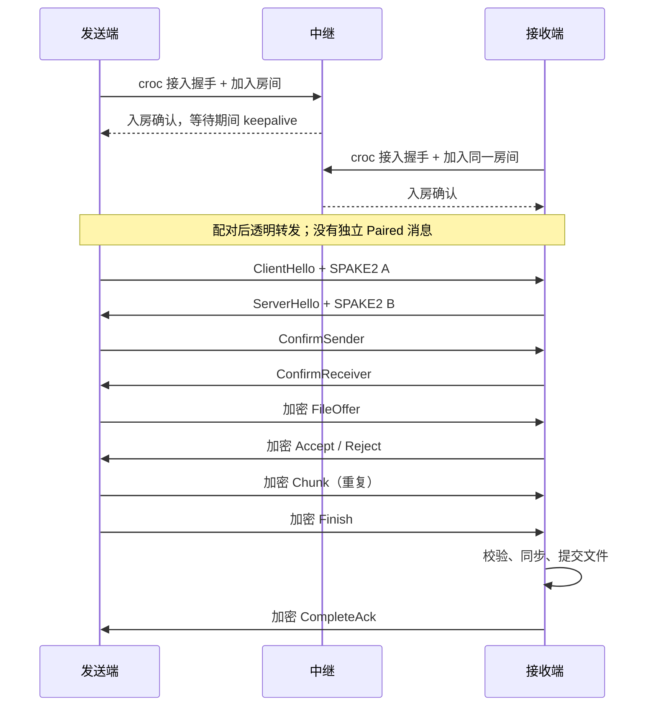

# Cayman：基于 Rust 的安全文件传输工具实施方案

> 当前交付更新：`send SOURCE` / `receive TARGET` 已默认选择 croc 中继；仅显式 `--listen` / `--connect` 使用直连。已实现 Rust 中继接入适配、SPAKE2 短码配对、端到端 TLS、固定块增量、轮询同步、冲突保护和原子落盘。中继适配已通过独立 Go 算术向量与内存协议测试，真实 Go relay / 公共节点互操作尚待验证。短码配对已接入，自动重连、删除传播和双向同步仍未实现。当前用法见 [README](../README.md)，兼容性边界见 [中继适配说明](relay-implementation.md)。

编写日期：2026-10-14。项目使用 Rust 2024 edition。本文件定义目标协议、模块和验收标准；已实现帧、密钥调度、加密记录、只读目录比对基础模块，当前功能及验证方式以 [README](../README.md) 为准，不能将本方案所有功能视为已实现。

新增需求详见 [性能、可靠性与实时增量同步方案](performance-reliability-sync.md)：包括目录比对、块级增量、文件监听、持续配对、自动恢复和双向冲突处理。本文描述基础传输阶段；持续同步的身份、通道和更新语义由扩展方案定义。

## 1. 目标与范围

实现一个使用短期暗号配对、通过不可信中继传输文件的命令行工具。发送方和接收方通过 SPAKE2 建立共享密钥，执行双向密钥确认，再通过 AES-256-GCM 加密通道交换文件信息和文件内容。

基础传输首版提供 `send`、`receive` 两个子命令，优先复用 Go croc 中继，支持单文件、自动生成暗号、流式传输、进度显示、完整性校验和安全落盘。首版不实现 Relay Server。断点续传随后交付；目录比对与实时增量同步已纳入正式 `sync` 路线，先单向安全、后双向安全，并分阶段引入 CDC、压缩和目录索引优化。直连、NAT 穿透及多连接并发仍为后续优化。

Cayman 的中继接入层以兼容 Go croc 为目标，端到端仍使用独立的 `cayman/1` 协议；传输两端都必须是 Cayman，不支持与官方 croc 客户端互传，也不将直接 TCP 连接等同于 NAT 穿透。

2026-10-14 调整：根据上游源码确认，中继配对后支持字节转发，因此协议层面可复用。当前结论基于源码审阅，尚未完成 Rust 互操作或公共中继实测；上线前需要锁定并验证具体 croc 版本。

## 2. 威胁模型与安全边界

假设攻击者可以监听、修改、重放、截断网络消息，也可以控制中继、抢占房间或主动尝试暗号。客户端设备和随机数源可信，暗号通过双方认可的其他渠道传递。

安全目标：

- 中继不获得秘密暗号、端到端会话密钥、文件名、文件摘要和明文内容；中继接入层自己的连接密钥不属于此保密目标。
- 错误暗号、握手篡改、密文篡改和帧重放导致会话终止。
- 未认证对端不能触发目标文件创建或覆盖。
- 失败或中断不留下看似完整的目标文件。

边界：中继仍可观察 IP、公开房间标识、流量大小和时间，也可以拒绝服务。PAKE 防止被动离线字典验证，但不能消除在线猜测；知晓完整暗号的人具备加入会话的能力。采用 AES-256 不代表整个协议具有 256 位安全强度。

## 3. 暗号与房间标识

建议格式：`<room-id>-<word1>-<word2>-<word3>-<word4>`。

- `room-id`：由系统安全随机数源生成的 80 位公开随机值，以 16 个小写 Base32 字符表示，只用于中继路由。
- 四个词：从固定的 2048 词 ASCII 词表独立均匀抽取，秘密部分熵为 44 位；词表需固定版本、去重并检查许可证。
- 房间标识与秘密词独立生成。中继只收到 `room-id`，客户端仅用秘密词作为 PAKE password，并将房间标识绑定到握手上下文。
- 不将完整低熵暗号的确定性哈希作为公开房间标识，否则该标识可成为离线猜测的验证依据。
- 固定大小写和分隔符规范，解析失败明确报错，不做模糊纠正；不支持任意弱密码作为正式模式默认值。

客户端默认配对有效期 10 分钟，中继自身可能更早回收房间。客户端每次配对只允许一次端到端 PAKE 认证尝试；认证失败后废弃暗号，由用户重新发起。已认证连接意外中断也通过新暗号、新握手恢复文件进度。中继限流属于服务端策略，客户端不能依赖其存在或正确执行。

上述重新分享暗号规则适用于一次性传输。长期 `sync` 配对使用首次 PAKE 授权、后续 TLS 设备认证自动重连，不重复使用短暗号，见扩展方案第 7 节。

秘密暗号默认通过交互输入，自动化使用标准输入或受限文件描述符。避免将暗号作为 CLI 位置参数写入进程列表和 shell 历史；日志禁止记录暗号、密钥和文件内容。

## 4. 协议分层与完整流程

协议分成中继配对、端到端握手、加密记录、文件传输四层。



### 4.1 复用 Go croc 中继

**兼容边界。** 上游 `clientHandshake` 执行客户端到中继的接入认证，`clientCommunication` 将同名房间的两个连接配对，`pipeWithProtocol` 双向转发字节。没有 Cayman 原方案中的 Create/Join 角色区分或独立 Paired 消息；角色验证必须由端到端协议负责。等待期间会出现载荷为单字节 `0x01` 的 keepalive。[中继源码](https://github.com/schollz/croc/blob/main/src/tcp/tcp.go)

**两层认证。** 接入握手使用 Go `schollz/pake` 的 `siec` 模式及固定输入 `{1,2,3}` 建立中继连接密钥，再交换 salt、加密的 relay password、banner、房间及入房确认。它与用户暗号驱动的端到端 SPAKE2 是两个独立过程。Rust `spake2` 不能直接替换 Go 协议，需要精确适配其算法、序列化和密钥编码；私有中继密码不得使用文件暗号。[接入实现](https://github.com/schollz/croc/blob/main/src/tcp/tcp.go) · [Go PAKE](https://github.com/schollz/pake)

**接入加密兼容。** 当前上游 `crypt.New` 使用 8 字节随机 salt、PBKDF2-HMAC-SHA256（100 次、32 字节输出）；加密消息为 AES-GCM 的 nonce 前缀加密文及标签。仅在兼容模块复现这些参数，端到端仍使用本方案的 HKDF 和方向密钥。该外层不提供 Cayman 对端身份认证。[加密源码](https://github.com/schollz/croc/blob/main/src/crypt/crypt.go)

**帧适配。** croc 帧为 `"croc" || payload_len:u32_le || payload`。拟在整个中继连接上保留该外层，每个 Cayman 握手帧或加密记录作为一条 payload，使等待心跳和业务帧可明确区分。适配器只在首次对端 Hello 前忽略合法 keepalive，且不能因此无限延长配对期限；之后收到该控制帧视为异常。缓冲中尚未消费的字节必须保留，不能切换阶段时丢失或错误解密。[帧源码](https://github.com/schollz/croc/blob/main/src/comm/comm.go)

**首版实现决策。** 使用单房间、单连接承载 Cayman 控制与文件数据，房间名建议为 `cayman-v1-<room-id>`。不实现 croc 多数据端口调度和可选快速接入扩展。接入适配器维护独立握手状态；端到端握手只有在接入成功后启动，发送端可先发 Hello 等待接收端，不能将入房成功当作配对完成。

建议本地限制：接入帧先采用 64 KiB 上限，并用固定版本真实握手样本校验；Cayman 握手帧 4 KiB；配对等待 10 分钟；首次收到对端 Hello 后认证期限 30 秒。入站长度在分配前检查，畸形响应、错误中继密码、房间满及网络中断分别映射为可诊断错误。

**公共服务与部署。** 协议适配成功后，可连接允许使用且可达的现有 croc 中继，因此有机会免去部署；这不等于已经获得公共服务的稳定性、配额或长期兼容保证。首版保留 `--relay` 配置并要求两端选择同一地址。公共节点地址、访问凭据和使用条件在接入验证时确认，不把尚未实测的节点写成默认值。若需要自有服务，可直接部署现成 Go croc relay，无需另写 Rust 服务端。[上游部署说明](https://github.com/schollz/croc#self-host-relay)

**兼容性门槛。** 在 P0 锁定上游 release/tag、commit 及其 PAKE 依赖版本，保存固定输入的跨语言向量。先在本地运行该版本 Go relay 验证 Rust 双端配对和传输，再进行公共节点小文件冒烟测试。`main` 链接仅是本次调研依据，不视为稳定协议规范。若纯 Rust 适配困难，Go 辅助进程仅作为原型验证路径，正式单二进制交付不默认引入 Go 运行依赖。

### 4.2 SPAKE2 握手与密钥确认

发送端固定为 A，接收端固定为 B；使用 `Spake2::<Ed25519Group>::start_a/start_b`，随后调用 `finish` 获取共享密钥材料。库文档区分密钥建立与额外的密钥确认，应用必须完成后者。[SPAKE2 crate 文档](https://docs.rs/spake2/latest/spake2/)

Hello 包含协议版本、固定密码套件标识、房间标识、角色及各自 32 字节随机数。首版只支持一个密码套件，未知版本或套件直接拒绝，不做静默降级。

使用带长度前缀的确定性编码构建 transcript，按发送端、接收端固定顺序包含两个 Hello 及两个 PAKE 消息。身份参数绑定 `cayman/1`、房间标识及 sender/receiver 角色。禁止直接拼接可变长度字段。

```text
T   = SHA256(canonical_transcript)
PRK = HKDF-Extract(salt = T, IKM = pake_shared_secret)

HKDF-Expand(PRK, "cayman/1/confirm/sender", 32)
HKDF-Expand(PRK, "cayman/1/confirm/receiver", 32)
HKDF-Expand(PRK, "cayman/1/key/sender-to-receiver", 32)
HKDF-Expand(PRK, "cayman/1/key/receiver-to-sender", 32)
HKDF-Expand(PRK, "cayman/1/nonce/sender-to-receiver", 4)
HKDF-Expand(PRK, "cayman/1/nonce/receiver-to-sender", 4)
```

两端使用各自确认密钥计算 `HMAC-SHA256(role_label || T)`，接收时通过库的常量时间验证接口检查。发送端先发送确认，接收端验证成功才回复确认；双方验证对方后才能进入文件协议。认证失败统一终止，不暴露密码匹配细节。

RFC 9382 可作为上下文绑定、密钥分离及确认流程的设计依据，但不能据此声称所选 crate 的编码和参数与 RFC 测试向量互通。实施时必须固定具体依赖版本，并根据实际实现建立测试向量。[RFC 9382](https://www.rfc-editor.org/rfc/rfc9382.html)

### 4.3 加密记录

所有业务消息均加密，包括文件名、大小、摘要、确认、错误和续传状态。只有配对和握手的必要信息公开。

本节自定义加密记录用于一次性传输和首次配对。持续 `cayman-sync/1` 会话采用独立 TLS 1.3 通道，不重复套用本节 AEAD 层；消息编解码和 croc 帧适配仍复用。

```text
record = length:u32_be || sequence:u64_be || ciphertext_and_tag
plaintext = message_type:u8 || message_payload
nonce = direction_nonce_prefix:4_bytes || sequence:u64_be
AAD = protocol_version || T || direction || length || sequence
```

`length` 表示其后整条记录的字节数，包含序号、密文和 16 字节认证标签，不含自身。AAD 各字段使用固定宽度或明确长度前缀。

两方向使用独立密钥和独立计数器，从 0 开始严格递增。接收端只接受预期序号，认证成功后推进计数器。任何读取、写入或认证失败都废弃当前通道；应用不得重试同一密钥与 nonce 的加密操作。AES-GCM 要求同一密钥下 nonce 唯一。[AES-GCM 文档](https://docs.rs/aes-gcm/latest/aes_gcm/)

每个方向暂定最多传输 64 GiB 明文或发送 2^24 条记录，以先到者为准，作为保守工程上限；生产发布前复核具体 GCM 使用界限。MVP 对可能超过上限的文件提前拒绝，记录层仍强制检查累计字节数和记录数。第二阶段允许经新握手、新密钥续传。计数器禁止回绕。

首版最大记录长度为 2 MiB、默认文件块为 1 MiB，握手帧另限 4 KiB。必须先验证长度再分配内存，解码字段还需各自限长，拒绝尾随数据、非法枚举及整数溢出。不得因为使用 TCP 而假设一次读取对应完整帧。

## 5. 文件传输与安全落盘

| 消息 | 方向 | 内容与语义 |
| --- | --- | --- |
| FileOffer | 发送 → 接收 | 随机会话传输 ID、基础文件名、大小、块大小；续传版增加预计算摘要 |
| Accept / Reject | 接收 → 发送 | 接收决定；续传版增加有界、分页的缺失区间 |
| Chunk | 发送 → 接收 | 传输 ID、块序号、原始数据 |
| ChunkAck | 接收 → 发送 | 第二阶段确认已持久化的块或连续区间 |
| Finish | 发送 → 接收 | 总大小、块数及发送过程中计算的 SHA-256 |
| CompleteAck | 接收 → 发送 | 完整校验和提交成功；发送端据此报告成功 |
| Error / Cancel | 双向 | 有界错误码与说明 |

MVP 使用单连接顺序传输和 TCP 背压，不做每块停等 ACK。加密会话认证通过后，接收端展示文件信息并默认询问是否接收；自动化可用 `--yes`。默认不覆盖已有文件。

接收端只接受基础文件名，拒绝空名、绝对路径、`..`、路径分隔符及目标平台非法名称，并允许用户指定本地文件名。网络提供的路径不得直接用于文件系统操作。

本节是单文件接收策略；目录同步允许经逐组件验证的授权根内相对路径，使用单独的冲突检查、历史版本和有条件更新流程，不能直接沿用“只接受基础名”或无条件覆盖。

在目标目录中以独占创建方式生成随机命名的临时文件，设置适当权限。使用防符号链接跟随和基于目录句柄的文件操作等平台能力控制路径逃逸，不能只用字符串清洗。最终提交使用平台支持的原子不覆盖操作，避免“先检查目标不存在，再普通 rename”的竞争覆盖。

发送与接收分别流式计算 SHA-256。接收端检查块序号、块长、总大小，只有完整接收、摘要匹配、同步文件成功并提交为最终文件后，才发送 `CompleteAck`。支持的平台还需同步父目录。零字节文件走同一完成流程。

发送端应持有同一打开的文件句柄，并比较传输前后的元数据；普通文件在并发修改时不提供一致快照保证，需要明确错误或建议使用快照源。发送端未收到完成确认时报告“结果未确认”，不能据此断言接收端未完成。

## 6. 断点续传设计（第二阶段）

第一版续传采用顺序传输的连续持久化前缀，以降低恢复复杂度；实现乱序或并发传输后再引入位图。保留 `resume.rs` 接口，避免将位图作为 MVP 的必要依赖。

续传版本在发送前预计算文件摘要，以摘要、大小及块大小定义内容身份，不能依赖文件名匹配。这样需要额外读一遍源文件；大文件应显示“准备/计算摘要”阶段。发送结束仍重新核对实际发送内容的摘要。

状态示意：

```json
{
  "version": 1,
  "file_sha256": "<hex>",
  "file_size": 123456789,
  "chunk_size": 1048576,
  "temp_file_id": "<local-random-id>",
  "durable_prefix_chunks": 32,
  "chunk_hashes": ["<hex-per-durable-chunk>"]
}
```

状态文件不保存暗号或会话密钥。临时文件标识由本地生成，恢复时禁止信任 sidecar 中的任意路径。状态大小、块数和摘要数量均按文件上限限制。

持久化顺序必须为：写数据 → 同步数据 → 写新状态临时文件 → 同步状态 → 原子替换状态 → 按平台同步目录 → 发送持久化 ACK。可每 16 MiB 或每秒进行一次批量提交，未提交的数据允许恢复时重传。

恢复时重新生成暗号并完成 PAKE，在加密通道中匹配内容身份。接收端验证临时文件、状态范围及已记录分块摘要，发现损坏则回退到首个损坏块；最终仍验证整文件摘要。重新传输必须使用新会话密钥，不能恢复旧加密计数器或复用旧密文。

未来引入位图时，必须定义稀疏块落盘一致性和缺失区间分页，防止巨大 bitmap 或单帧范围列表耗尽内存。

## 7. Rust 工程结构与依赖

沿用当前单 crate，增加 `lib.rs` 以便集成测试，暂不拆 workspace。

```text
src/
├── main.rs                 # 运行时、退出码
├── lib.rs
├── cli.rs                  # 参数与交互策略
├── error.rs                # 分层错误及对外映射
├── crypto/
│   ├── mod.rs
│   ├── code.rs             # 暗号生成、规范化与解析
│   ├── pake.rs             # SPAKE2 与密钥确认
│   └── cipher.rs           # 方向密钥、nonce、计数器
├── protocol/
│   ├── mod.rs
│   ├── frame.rs            # 有界长度前缀编解码
│   ├── message.rs          # 明确类型编号和字段布局
│   └── handshake.rs        # 状态机与 transcript
├── relay/
│   ├── mod.rs
│   ├── client.rs
│   └── croc_compat/
│       ├── mod.rs          # 固定版本 croc 接入适配
│       ├── frame.rs        # croc magic、小端长度、keepalive
│       ├── admission.rs    # 中继接入握手与密码认证
│       └── pake.rs         # Go PAKE 互操作，区别于端到端 SPAKE2
└── transfer/
    ├── mod.rs
    ├── sender.rs
    ├── receiver.rs
    ├── storage.rs          # 临时文件、同步、安全提交
    └── resume.rs           # 第二阶段
tests/
├── handshake.rs
├── relay.rs
├── transfer.rs
└── adversarial.rs
```

| 用途 | 依赖候选 | 约束 |
| --- | --- | --- |
| 异步网络与文件 | tokio、bytes | 使用有限缓冲和显式超时 |
| PAKE | spake2 | 封装角色，禁止重复使用握手状态 |
| croc 接入兼容 | pbkdf2；匹配 Go PAKE 的曲线/编码依赖待 P0 确定 | 以跨语言向量验证，不复用端到端 spake2 实现 |
| AEAD 与派生 | aes-gcm、hkdf、sha2、hmac | 分方向密钥、常量时间 MAC 验证 |
| 随机与秘密内存 | rand_core/getrandom、zeroize | 按所选版本核对 RNG trait 兼容性，尽力清理秘密 |
| CLI 与进度 | clap、indicatif | 进度输出 stderr，保持 stdout 可脚本化 |
| 状态序列化 | serde、serde_json | 用于本地 sidecar，验证版本与字段上限 |
| 错误与日志 | thiserror、anyhow、tracing | 库返回结构化错误，入口添加上下文，日志脱敏 |
| 测试 | tempfile、proptest | 临时目录、随机帧及边界测试 |

网络核心头部和端到端握手使用明确的手写定长/限长编码；croc 接入层必须遵循上游实际编码。避免依赖 Rust 枚举顺序作为线上类型编号。若后续引入 bincode 等载荷编码器，必须固定版本、配置、解码上限及兼容性向量。

实施时锁定经编译验证的依赖组合并提交 `Cargo.lock`，不直接复制旧版本示例 API。HKDF 的 Extract/Expand 用法以所锁版本的官方文档为准。[HKDF 文档](https://docs.rs/hkdf/latest/hkdf/)

类型边界建议：`RelayConnection` 只能进入握手；成功后返回持有独立读写状态的 `SecureChannel`。业务层只能通过 `SecureChannel::send/recv` 访问消息，不接触裸 socket、密钥或 nonce。阻塞摘要计算和大量磁盘工作应避免占用异步执行器。

## 8. CLI 设计

以下为计划接口，并非当前已可运行命令：

```bash
# 发送；连接已有的 Go croc 中继，输出一次性暗号
cayman send ./archive.tar --relay relay.example.com:9009

# 接收；交互输入暗号，预览信息后确认
cayman receive --relay relay.example.com:9009 ./downloads

# 第二阶段：显式启用续传，仍使用新暗号
cayman receive --relay relay.example.com:9009 ./downloads --resume
```

首版要求显式指定中继，上例域名为占位符。私有中继凭据通过单独的受限输入提供，不与一次性文件暗号混用。后续验证公共节点后可增加默认配置。进度区分准备、中继接入、等待配对、端到端认证、传输、校验和提交。Ctrl-C 发送尽力而为的加密取消消息并清理连接；首版清理临时文件，续传版保留已提交检查点。

退出码建议：0 成功、1 本地/普通错误、2 参数错误、3 认证失败、4 网络中断或超时、5 完整性校验失败、6 用户拒绝或取消。完成确认丢失的错误文本需提示结果不确定。

## 9. 实施顺序与验收

| 阶段 | 交付内容 | 验收条件 |
| --- | --- | --- |
| P0 协议冻结与兼容探针 | 固定 croc/PAKE 版本、跨语言接入向量、Cayman 帧与状态机 | Rust 能完成目标 Go relay 接入；端到端编码无歧义 |
| P1 安全通道 | 内存双工/本地 TCP 上 PAKE、HKDF、确认、AEAD | 同暗号互通，错误暗号和握手篡改失败，方向密钥与序号隔离 |
| P2 中继适配 | croc 帧、接入认证、房间等待和连接管理 | 双端经真实 Go relay 互通，正确处理心跳、房间满、错误密码及断线 |
| P3 单文件 MVP | CLI、暗号、文件流、摘要、安全落盘、进度 | 两个独立客户端通过中继传完文件并获得最终确认 |
| P4 续传 | 内容身份、持久化检查点、重新握手恢复 | 杀进程/断网/损坏状态后安全恢复，已持久化块无需重传 |
| P5 发布准备 | 威胁测试、模糊测试、跨平台文件行为、依赖审查 | 已知边界有回归测试，协议和使用文档完整 |

安全和正确性测试必须覆盖：

- 握手：不同暗号、错误角色、房间或版本替换、确认消息反射、握手重放、超时。
- 记录：错误认证标签、重复/跳跃序号、截断帧、超大长度、非法类型、密钥使用上限。
- 文件：空文件、恰好整块、最后不足一块、非 ASCII 名称、路径穿越、符号链接、已有文件、磁盘不足。
- 网络：任意 TCP 拆包/合包、慢接收端、发送中断、最终 ACK 丢失，中继恶意改写和丢弃。
- croc 兼容：固定版本 Go relay 互操作、入房响应与首个业务帧连续到达、等待心跳、双端先后顺序、错误接入密码及房间占用；公共服务只做小规模冒烟验证，不承担故障注入测试。
- 续传：每个持久化步骤之间崩溃、状态领先于数据、临时文件被修改、源文件变化、新密钥下恢复。

验证命令为 `cargo fmt --check`、`cargo clippy --all-targets -- -D warnings` 和 `cargo test`；发布准备阶段另做依赖漏洞与许可证检查、解码器 fuzz，以及 Linux/macOS/Windows 的落盘语义测试。

性能验收以实际环境测量：记录纯 TCP 基线、加密吞吐、CPU、峰值内存和校验耗时；文件增大时缓冲内存应保持有界，不预先承诺未经测量的吞吐数字。

在此基础上继续交付扩展方案 S0–S4：性能和恢复基线、单次目录增量、实时单向同步、CDC/规模优化、双向同步及删除策略。基础 P5 验证通过不等于已经完成这些同步能力。

## 10. 后续演进

直连模式首先支持显式可达地址，并复用相同的端到端握手及文件协议。自动直连候选地址应在认证后的控制通道中交换；切换传输路径时建立新会话或设计经审查的通道绑定，不能在多个连接上共享同一 nonce 计数器。NAT 穿透需要额外的地址发现、打洞和失败回退设计。

多文件与目录同步已在扩展方案中定义加密清单、路径策略、内容比对、块复用、逐文件提交及实时监听。该方案也定义了压缩边界、内存预算、流水线并发和故障测试；多连接并发仍需额外通道认证和流控设计。

生产使用前需要针对组合后的完整协议开展独立安全审查；采用成熟密码库并不自动证明应用协议安全。
